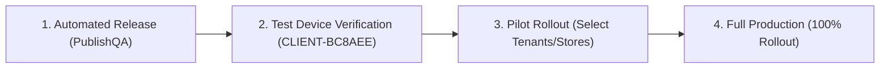

# THQ Business — One-Click Build & Release Automation Guide

This guide describes how to use the automated build and release system for **THQ Business** (Windows x64).

---

## 1. Quick Start

### Option A: Double-Click Launcher
Double-click `RELEASE_THQ_BUSINESS.bat` in `D:\ERP\` or `D:\ERP\flexi_erp\`.

This opens an interactive menu:
```text
========================================================================
           THQ BUSINESS - ONE-CLICK RELEASE AUTOMATION LAUNCHER         
========================================================================
 Repository Root: D:\ERP\flexi_erp
 Target Device:   CLIENT-BC8AEE (bc8aeec1-9bce-4935-b349-168caf9a7fa4)
 Channel:         internal_test
========================================================================
  [1] Build THQ Business Installer Locally (BuildOnly)
  [2] Check Next Release Version and Configuration (CheckRelease)
  [3] Publish QA Update (PublishQA)
  [4] View Latest Release / Workflow Result (ViewLatest)
  [5] Exit
========================================================================
Select an option (1-5):
```

### Option B: PowerShell CLI
Run commands directly from PowerShell:
```powershell
# Mode A: Build installer locally without publishing
.\tools\windows_release\RELEASE_THQ_BUSINESS.ps1 -Mode BuildOnly

# Mode B: Pre-flight check (branch, tags, uniqueness, credentials)
.\tools\windows_release\RELEASE_THQ_BUSINESS.ps1 -Mode CheckRelease

# Mode C: Publish QA update to authorized test PC via GitHub Actions
.\tools\windows_release\RELEASE_THQ_BUSINESS.ps1 -Mode PublishQA

# Mode D: Inspect currently active published release and workflow runs
.\tools\windows_release\RELEASE_THQ_BUSINESS.ps1 -Mode ViewLatest
```

### Option C: Batch CLI
From `cmd.exe`:
```cmd
RELEASE_THQ_BUSINESS.bat -Mode BuildOnly
RELEASE_THQ_BUSINESS.bat -Mode CheckRelease
RELEASE_THQ_BUSINESS.bat -Mode PublishQA
RELEASE_THQ_BUSINESS.bat -Mode ViewLatest
```

---

## 2. Operation Modes Explained

### Mode A: `BuildOnly`
- **What it does**: Invokes `D:\ERP\THQ_Business_Inno_Setup_Source\BUILD_THQ_BUSINESS_SETUP.ps1` using Inno Setup 7 (`ISCC.exe`) and Flutter.
- **Version handling**: Uses the current local version in `apps/client_app/pubspec.yaml` without incrementing it.
- **Divergence Protection**: If the local workspace version (e.g. `8.2.2+19`) diverges from the latest release baseline tag (e.g. `v8.2.3+22`), `BuildOnly` **blocks by default** to prevent producing stale installer artifacts.
  - To deliberately compile local workspace code without updating release tags, use the explicit override:
    ```powershell
    .\tools\windows_release\RELEASE_THQ_BUSINESS.ps1 -Mode BuildOnly -AllowDivergentBuild
    ```
- **Artifact output**: Generates `THQ_Business_Setup_v<version>_Build<build>.exe` in `D:\ERP\THQ_Setup\`.
- **Logs**: Preserves a full timestamped compilation log in `D:\ERP\THQ_Setup\thq_build_log_<timestamp>.txt`.
- **Safety**: Makes **zero network calls**, touches **no live databases**, creates **no Git commits or tags**.

### Mode B: `CheckRelease`
- **What it does**: Inspects local Git status, uncommitted changes, local & remote Git release tags, and the live Supabase release registry.
- **Readiness vs Calculation**: Unambiguously separates:
  - `candidate_valid`: Whether the next proposed version/build is valid and avoids collisions with known tags and records.
  - `publication_ready`: Whether the release can be published right now (requires complete authenticated registry verification, clean tree, pushed branch).
  - `branch_in_sync`: Whether local workspace files match the release baseline (`8.2.3+22`).
- **Version calculation**: Automatically computes the next valid semantic version and build number:
  - If current semver is already released/registered, advances the patch (`8.2.3 -> 8.2.4`) to satisfy the Supabase `(app_key, platform, version)` uniqueness constraint.
  - Automatically increments build number monotonically (`22 -> 23`).
  - Verifies no collision with existing tags or registry records across multi-page PostgREST pagination.
- **Prerequisites validation**: Checks `gh.exe` presence and authentication status, workflow availability, and QA device targeting.
- **Safety**: Read-only diagnostic check. Modifies **nothing**.

### Mode C: `PublishQA`
- **What it does**: Executes end-to-end automated QA release publication via GitHub Actions.
- **Safety Pre-flights**:
  1. Verifies working tree is **clean** (refuses to run with uncommitted changes).
  2. Verifies local commit is **pushed to origin** (`origin/<branch> == HEAD`).
  3. Verifies `gh.exe` is **authenticated**.
  4. Automatically allocates a **unique** version and build number.
  5. Displays a confirmation summary requiring explicit user confirmation before dispatching.
- **Execution & Monitoring**:
  1. Triggers `.github/workflows/thq-release-windows.yml` on GitHub Actions via `gh workflow run`.
  2. Follows workflow progress in real-time.
  3. Verifies Authenticode code signing with internal QA thumbprint `2813DEE08CC4B318907D2F5243DF81DA95EF60A7`.
  4. Uploads to Supabase private storage `thq-releases`.
  5. Registers release strictly targeted to device `CLIENT-BC8AEE` (`bc8aeec1-9bce-4935-b349-168caf9a7fa4`).
  6. Verifies discovery via `app_release_check_v820` RPC for `CLIENT-BC8AEE`.
  7. Verifies device isolation (unauthorized devices receive `update_available=False`).

### Mode D: `ViewLatest`
- Inspects the active release currently discoverable by `CLIENT-BC8AEE` in Supabase.
- Inspects recent GitHub Actions workflow runs.
- Inspects recent Git release tags.

### Mode E: `Menu`
- Interactive console menu providing quick single-key access to `BuildOnly`, `CheckRelease`, `PublishQA`, `ViewLatest`, or `Exit`.
- Default behavior when running `RELEASE_THQ_BUSINESS.bat` by double-clicking without parameters.

---

## 3. Versioning Policy & Architecture

### Single Source of Truth
- The authoritative version and build number baseline is determined dynamically by `manage_version.py` from **Git release tags** (`refs/tags/vX.Y.Z+B`) and the **Supabase release registry** (`platform_app_releases`).
- Package metadata files (`apps/client_app/pubspec.yaml`, `packages/erp_core/lib/src/release_contract.dart`, and `tools/windows_release/THQ_Business.iss`) are synchronized automatically during release compilation.

### The Registry Uniqueness Rule
The Supabase release registry table `public.platform_app_releases` has a hard uniqueness constraint:
```sql
UNIQUE (app_key, platform, version)
```

**Why Build 21 and Build 22 collided previously**:
- Build 21 was published as `version: "8.2.3"`, `build_number: 21`.
- Build 22 was published with `bump_type=auto_build`, which preserved `version: "8.2.3"` while only bumping `build_number: 22`.
- When Build 22 reached the registry, `publish_release.py` detected that `(client, windows, 8.2.3)` already existed, and issued a `PATCH` update, **overwriting Build 21's record**.

**The Automated Fix**:
- `manage_version.py` queries all known versions across Git tags (`local` and `remote` via `ls-remote`), Supabase RPC (`app_release_check_v820`), and an authenticated PostgREST table query whenever `SUPABASE_SERVICE_ROLE_KEY` is available.
- If `current_version` (e.g. `8.2.3`) is already registered or tagged, `auto_build` **automatically advances the patch version** (`8.2.4`) and increments the build number (`23`).
- `publish_release.py` fails closed if an existing record for `(app_key, platform, version)` already exists, prohibiting destructive overwrites.
- In CI, `--enforce-complete-registry` ensures that publication fails closed if the complete registry cannot be queried.

### Safe Branch Synchronization
- During CI release publication, after compiling and signing the artifacts, the workflow creates a bot commit (`chore(release): bump version to $v+$b [skip ci]`) and tags it with `v$v+$b`.
- The workflow performs a **fast-forward only** update to the target branch (`origin/<branch>`), verifying that the remote branch has not advanced since checkout (`$remoteSha == $initialSha`).
- If concurrent work has advanced the remote branch or if branch protection blocks direct bot pushes, the push is skipped safely without using force (`--force` is forbidden). The release tag retains the immutable release provenance.

---

## 4. Required Credentials & Tools

| Tool / Credential | Required For | Where Configured / How to Provide |
|---|---|---|
| **Flutter SDK** | Local Builds | On system `PATH` |
| **Inno Setup 7** (`ISCC.exe`) | Local Builds | Default: `C:\Program Files\Inno Setup 7\ISCC.exe` |
| **GitHub CLI** (`gh.exe`) | PublishQA | Default: `C:\Program Files\GitHub CLI\gh.exe`. Authenticate via `gh auth login`. |
| `THQ_WINDOWS_SIGN_PFX_BASE64` | CI Code Signing | GitHub Actions Environment Secret (`release-publishing`). Base64-encoded PFX file. |
| `THQ_WINDOWS_SIGN_PASSWORD` | CI Code Signing | GitHub Actions Environment Secret (`release-publishing`). PFX password. |
| `THQ_WINDOWS_EXPECTED_THUMBPRINT` | CI Production Signing | GitHub Actions Secret. SHA-1 thumbprint of the production certificate. |
| `SUPABASE_SERVICE_ROLE_KEY` | CI Storage Upload & Discovery | GitHub Actions Environment Secret (`release-publishing`). Service role secret key. |
| `SUPABASE_URL` | Release Discovery | GitHub Actions Environment Variable (`vars.SUPABASE_URL`) or defaults to `https://yguzrxcdvyimjrfvtcvp.supabase.co`. |

---

## 5. In-App Automatic Updater & OTA Lifecycle

The THQ ERP client applications (**THQ Business** and **THQ POS**) feature an automated in-app updater that upgrades existing installations in place without manual file distribution:

### The 18-Step Upgrade Lifecycle
1. **Periodic Discovery**: Client calls RPC `app_release_check_v820` with current `app_key`, `platform`, `current_version`, `current_build`, `device_id`, and `tenant_id`.
2. **Targeting Evaluation**: The RPC evaluates release status (`published`, `stable`, `beta`), device whitelist, tenant whitelist, rollout percentage, and minimum supported version.
3. **Update Notification**: If eligible, the app displays the new version banner in the workspace and in **Support Screen > Software Updates**.
4. **User Action**: For optional updates, the user chooses *Download Update* or *Later*. Mandatory updates enforce update before proceeding.
5. **Private Authorized Download**: Client contacts Edge Function `app-release-download` with an hourly HMAC authorization token.
6. **Token Verification**: Edge Function confirms device status and release eligibility, then mints a 15-minute presigned download URL to private bucket `thq-releases`.
7. **Integrity Verification**: `SoftwareUpdateVerifier` verifies exact byte length and SHA-256 hash against published metadata. Corrupt or incomplete files are discarded.
8. **Digital Signature Check**: Verifies Authenticode signature status is `Valid` and matches the trusted publisher identity.
9. **Disk Space Check**: Verifies at least 200 MB free disk space before beginning installation.
10. **Session Tracking**: Records pending upgrade attempt in `%APPDATA%\THQ ERP\updates\thq_update_session.json`.
11. **Detached Coordinator Handoff**: `WindowsUpdateCoordinator` launches `thq_update_coordinator.ps1` detached via `cmd.exe /c start ""` with a 4-second handoff confirmation deadline.
12. **Safe Application Exit**: Main Flutter app cleanly exits (`exit(0)`).
13. **Pre-Update Backup**: Coordinator backs up existing `{app}` application binaries to `%APPDATA%\THQ ERP\updates\backup_v<version>_b<build>/`.
14. **Elevated Inno Setup**: Coordinator executes Inno Setup with `/DIR="{app}" /SILENT /CLOSEAPPLICATIONS -Verb RunAs`.
15. **Automatic Rollback on Failure**: If installer fails (non-zero exit code or missing executable), coordinator immediately restores original binaries from backup.
16. **Application Relaunch**: Coordinator launches the updated executable (`thq_business.exe` or `thq_pos.exe`).
17. **Post-Restart Version Verification**: On launch, the app reads session state, verifies that running build equals target build, and cleans up installer files.
18. **Telemetry Audit**: Logs success or diagnostic error details to `public.platform_app_update_logs` via RPC `app_update_log_record_v820`.

### Data and Configuration Preservation
- **Application Binaries**: Located in `{ProgramFiles}\THQ\Business` or `{ProgramFiles}\THQ\POS`. Only these files are replaced during updates.
- **Customer Data & Activation**: Located in `%APPDATA%\THQ ERP\` and `%LOCALAPPDATA%` (Windows Credential Manager, SQLite caches, device activation tokens, offline queues).
- **Result**: Customer configurations, store memberships, pending offline transactions, and local databases remain untouched across all upgrades.

---

## 6. Staged Rollout & Release Promotion

To safely deliver updates to clients without exposing untested builds to production:



1. **Internal Test Stage (Automated)**:
   - Automated releases default to `channel: internal_test` strictly targeted to `target_device: CLIENT-BC8AEE` (`bc8aeec1-9bce-4935-b349-168caf9a7fa4`).
   - All other devices receive `update_available: false`.
2. **Pilot Customer Stage**:
   - In Supabase Studio or Admin App, navigate to **Release Management**.
   - Edit the release record: set `channel = 'beta'`, add pilot tenant UUIDs to `target_tenant_ids`.
3. **Full Production Stage**:
   - Set `channel = 'stable'`, `status = 'published'`, clear device/tenant restrictions, set `rollout_percentage = 100`.
   - All client applications immediately discover the verified release.

---

## 7. Pausing or Withdrawing a Release

If a critical issue is discovered in a published release:
1. Open Supabase Studio or execute:
   ```sql
   UPDATE public.platform_app_releases
   SET status = 'paused' -- or 'withdrawn'
   WHERE id = '<release-uuid>';
   ```
2. **Immediate Effect**:
   - `app_release_check_v820` immediately stops offering the update to any client.
   - `app-release-download` Edge Function immediately blocks downloads with `HTTP 403 Forbidden`.
   - Running clients that have not yet installed will decline the update.

---

## 8. Database Migration Deployment

To deploy release-related database migrations (such as `20261028160000_restore_build21_historical_release.sql`):
```cmd
cd D:\ERP\flexi_erp
supabase db push --linked
```
This safely applies the transaction-wrapped migration, creating the active-version and artifact-build partial unique indexes and restoring historical Build 21 without touching Build 22 or legacy data.

---

## 9. Recovery & Troubleshooting

### Problem: "Working tree is dirty" during PublishQA
**Cause**: You have uncommitted modifications or untracked files in `D:\ERP\flexi_erp`.
**Solution**: Commit your changes (`git commit -m "..."`) or stash them (`git stash`) before triggering a release.

### Problem: "Local commit has not been pushed to origin"
**Cause**: The GitHub Actions runner executes code on the remote GitHub branch. If local commits aren't pushed, the runner builds an older commit.
**Solution**: Run `git push origin <your-branch>`.

### Problem: "GitHub CLI is not logged in"
**Cause**: `gh.exe` has no stored session token.
**Solution**: Open terminal and run:
```cmd
gh auth login
```
Follow the web browser prompt to authenticate.

### Problem: Workflow Failed in GitHub Actions
1. Run `.\tools\windows_release\RELEASE_THQ_BUSINESS.ps1 -Mode ViewLatest` to check recent workflow runs.
2. View the failure log with `gh run view --log-failed` or on GitHub Actions.
3. Fix the issue, push your fix, and re-run PublishQA.
4. Because existing tags and records are immutable, the system will automatically allocate the next unique build number upon retry.
