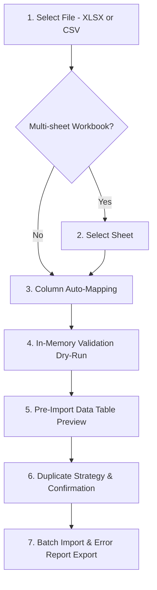

# THQ ERP — Smart Product Catalogue Import Guide

**Milestone:** Phase 7  
**Target Applications:** `apps/client_app`  
**Shared Engine:** `packages/erp_core/lib/src/import/`  
**Last Updated:** 2026-11-11  

---

## 1. Overview

The THQ Smart Product Import Engine enables business managers, stock controllers, and administrators to bulk import product catalogues into THQ ERP directly from supplier-provided spreadsheets.

### Supported File Formats
- **Excel (.xlsx):** Standard OpenXML spreadsheets created by Microsoft Excel, LibreOffice, or Google Sheets. Supports multi-worksheet selection.
- **CSV (.csv):** Standard RFC 4180 comma-separated, semicolon-separated, or tab-delimited text files with UTF-8 encoding (with or without BOM).

---

## 2. Standard Product Fields & Templates

THQ ERP provides downloadable sample templates in both CSV and Excel formats directly within the Smart Inventory Import workspace:
- **Download CSV Template:** Standard UTF-8 CSV with byte order mark (`EF BB BF`) ensuring correct display in Microsoft Excel.
- **Download Excel Template:** Formatted Excel workbook with pre-configured header columns and sample construction / retail items.

### Catalogue Fields

| Field Name | Mandatory | Description | Example |
| :--- | :--- | :--- | :--- |
| **Product Name** | **Yes** | Primary catalog title of the product | `UltraTech Cement 50kg` |
| **SKU** | **Yes** | Unique Stock Keeping Unit code | `SKU-CEM-50` |
| **Barcode** | No | Primary EAN-13, UPC, Code 128, or QR code | `8901030382910` |
| **Description** | No | Extended product description or specifications | `Standard Grade 53 Portland Cement bag` |
| **Category** | No | Product classification or department | `Cement & Concrete` |
| **Brand** | No | Manufacturer, make, or brand name | `UltraTech` |
| **Base Unit** | No | Inventory unit of measure (PCS, BAG, CFT, KG, BOX) | `BAG` |
| **Item Type** | No | Product nature (`stock`, `service`, `aggregate`) | `stock` |
| **Selling Price** | No | Default unit sales price before taxes | `380.00` |
| **Cost Price** | No | Purchase / acquisition cost (permission-guarded) | `310.00` |
| **List Price** | No | Maximum Retail Price (MRP) | `410.00` |
| **Tax Rate (%)** | No | Applicable GST / VAT rate (0, 5, 12, 18, 28) | `18` |
| **Reorder Level** | No | Minimum threshold alerting stock replenishment | `50` |
| **Part Number** | No | OEM part number or supplier part code | `UT-CEM-53` |
| **Opening Stock** | No | Staged count (non-mutating informational note) | `100` |

> [!IMPORTANT]
> **Preservation of Leading Zeros:** Numeric codes like `0012345678905` or `04523` are strictly treated as strings. The THQ import engine never converts barcodes or SKUs into floating-point numbers or scientific notation.

---

## 3. The 7-Step Import Workflow

The THQ Client application implements a guided 7-step desktop import workflow located under **Smart Inventory Workspace -> Tab 5: Product Import** (or via the **Import Products** button in the **Product Catalog** toolbar):

### Step 1: File Selection & Upload
- Drag-and-drop or click **Browse Files** to select a `.xlsx` or `.csv` file.
- The engine checks file headers and row counts automatically.

### Step 2: Worksheet Selection
- If the uploaded Excel file contains multiple worksheets (e.g. `Cement`, `Steel`, `Safety`), a sheet selector dropdown lets the user choose which sheet to import.

### Step 3: Column Field Mapping
- **Intelligent Auto-Mapping:** The engine analyzes source column headers against extensive supplier synonym dictionaries and assigns mapped fields with confidence scores:
  - **Auto (High):** Exact or standardized synonym match (e.g. `Item Code` -> `SKU`, `Bar Code` -> `Barcode`).
  - **Auto (Med):** Partial substring match.
  - **Manual / Low:** Unrecognized column assigned by the user.
  - **Ignored:** Columns mapped to `Do Not Import`.
- **Manual Override:** Every column has a dropdown to manually reassign or ignore fields.
- **Required Fields Alert:** If mandatory fields (`Product Name` or `SKU`) are missing, a warning banner highlights the unmapped columns.

### Step 4: Non-Destructive Validation Dry-Run
- The validation engine evaluates every row against catalog rules in-memory:
  - Verifies presence of non-empty Product Name and SKU.
  - Enforces positive selling price bounds.
  - Validates tax rate bounds (0% to 100%).
  - Evaluates duplicate collisions within the file and against live database records.

### Step 5: Visual Pre-Import Preview
- **Summary Metrics:**
  - Total Rows
  - Ready to Import (Valid)
  - Errors Found (Invalid)
  - Catalog Matches (Duplicates)
- **Status Filters:** Segmented buttons filter preview rows by `All`, `Valid`, `Errors`, or `Duplicates`.
- **Search Bar:** Real-time text search filters preview rows by SKU, Product Name, Barcode, or Category.
- **Desktop Data Table:** Dense scrollable table displaying row number, status badge, SKU, Name, Barcode, Selling Price, Cost Price (if permitted), Category, and issue tooltips.

### Step 6: Duplicate Resolution Strategy & Confirmation
Before execution, the user selects how duplicate products should be handled:
1. **Skip Duplicates (Recommended):** Duplicates are skipped; only brand-new products are created.
2. **Import New Only:** Enforces strict uniqueness; existing records are omitted.
3. **Update Existing Products:** Overwrites catalog details (selling price, description, tax rate, brand) for matched SKUs via `inventory_update_product_v628`.
- **Confirmation Dialog:** Summarizes row totals, created count, skipped count, assigned store scope, and the non-mutating inventory invariant.

### Step 7: Batch Execution & Failure Export
- Valid rows are sent to backend RPC `inventory_bulk_create_products` in controlled chunks of 50 rows.
- A progress bar tracks real-time batch execution.
- Upon completion, a results card displays:
  - Total Processed
  - Created Count
  - Updated Count
  - Skipped Count
  - Failed Count
  - Execution Duration
- **Download Failure Report (CSV):** If any row fails during execution (e.g. database constraint violation), clicking the button downloads a CSV report detailing `Row Number`, `Product Name`, `SKU`, and the exact database error.

---

## 4. Key Accounting & Inventory Invariants

> [!CAUTION]
> **Live Stock Balance Invariant:**
> Importing a product catalogue **NEVER** mutates live inventory balances in `public.location_stock_balances` or creates movement ledger entries.
>
> If an opening stock column is present in the uploaded file, the engine displays an informational warning that live stock adjustments must be posted through verified Stock Inward, Purchase Invoices, or Physical Stock Count Reconciliation (Phase 9).

---

## 5. Security & Access Control

| Role / Permission | Access Level |
| :--- | :--- |
| `owner` / `admin` | Full import access, duplicate strategy selection, cost price viewing and editing. |
| `inventory.manage` | Full import access and cost price viewing. |
| `bulk_import.use` | Full product import capability (cost price column suppressed if lacking financial role). |
| `inventory.view` / Staff | Read-only catalog access. Cannot execute product catalogue imports. |

---

## 6. Troubleshooting Common Issues

| Issue | Cause | Resolution |
| :--- | :--- | :--- |
| **"Missing required column: Product Name"** | The spreadsheet header was not recognized. | In Step 3 (Column Mapping), locate your product title column and select `Product Name *` from the dropdown. |
| **"Leading zeros missing in barcodes"** | File was opened and saved in an older spreadsheet tool without text formatting. | Ensure barcode columns are saved as Text. Download the official THQ template to preserve string formatting. |
| **"Import blocked: X duplicates detected"** | Source spreadsheet contains SKUs that already exist in the catalog. | Change Duplicate Resolution Strategy to **Skip Duplicates** to import only new items, or **Update Existing** to refresh catalog data. |
| **"Cost price column missing in preview"** | Active user does not hold financial permissions. | Expected behavior. Users without `inventory.manage` or `owner` permissions cannot view or import cost price figures. |
